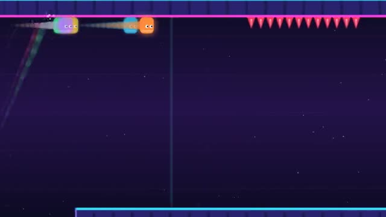

# Gravity Run

One button flips gravity. First to the end wins. A multiplayer starter game from [Multiplayer Agent](https://multiplayeragent.com): 2D, versus, 2–8 players, with bots that fill empty seats.

## How it plays

Everyone runs on their own, at the same speed. Flip between the floor and the ceiling to dodge gaps, spikes and walls, and hit speed pads to pull ahead. Fall off and you're sent back to the start of that stretch. First to the finish wins; when time runs out, whoever got furthest wins. Everyone races the same course, with the others shown as see-through ghosts.

**Controls:** Space, ↑ or click to flip gravity. On touch, tap anywhere or the Flip button.

## Make it yours in the Game Builder

Open the [Game Builder](https://multiplayeragent.com), choose **Start from a starter game** and pick Gravity Run. It opens as version 1 in your studio, ready to play and publish. Then ask for changes, for example:

- Add a portal that turns gravity sideways for a few seconds
- Make the course an underwater cave with bubbles that slow you down
- Add coins on the course and show who collected the most

## Run it yourself

1. Get a free publishable key (`pk_…`) at [multiplayeragent.com](https://multiplayeragent.com).
2. In `index.html`, put it in place of `pk_REPLACE_ME` in the `MP_CONNECT` block.
3. Open `index.html` in a browser. No build step and no server needed.

Without a key it still runs, offline against bots.

## How it is built

- One `index.html`. The comment at the top of the script maps the code and explains the multiplayer.
- The course pieces are drawn as text in `CHUNKS`: add or edit a piece and it shows up in the races.
- **Leaderboard:** The players who won the most races.
- **Host-run rounds:** The host's browser runs the countdown, records who finishes and when, and starts the next race; if it leaves, the next player takes over.
- **Bots:** Bots race you and fill the start line until enough people join.
- **Live sync:** Everyone runs the same course, with the other runners shown as see-through ghosts.
- `?attract` runs it offline with bots only. The preview video is recorded from it.

## License

MIT.
